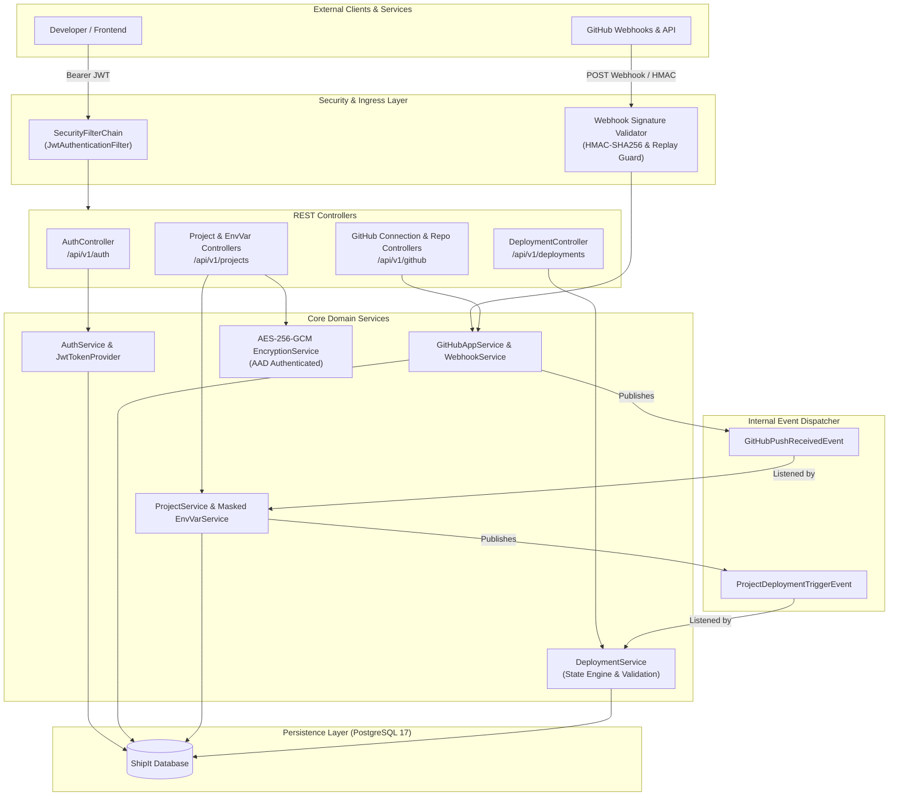
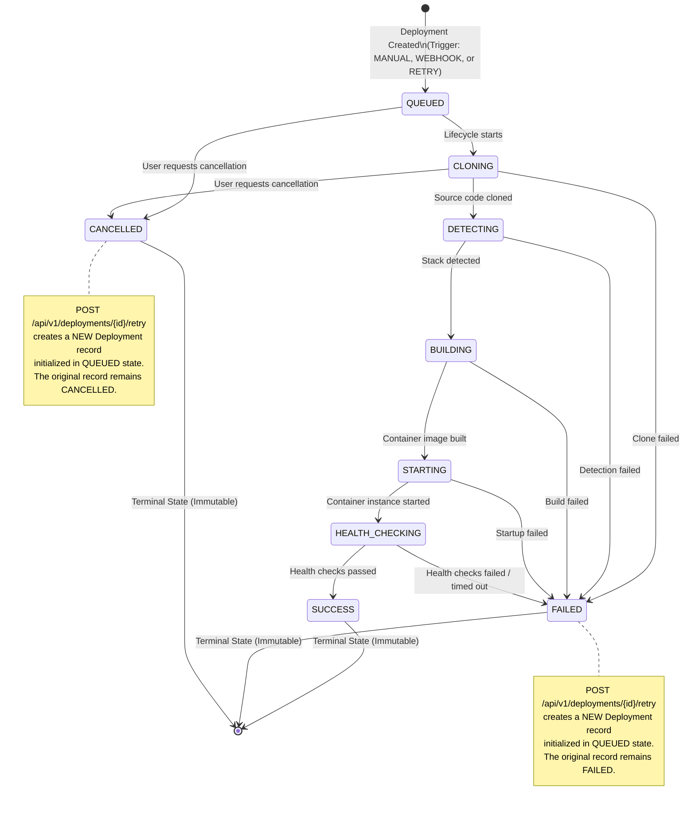

# ShipIt — Lightweight Self-Hosted PaaS (Backend)

[]()
[]()
[]()
[]()
[]()
[]()
[]()
[]()

> **Project Status:** ShipIt is currently **under active development**. Modules 1 through 4 (Authentication, GitHub Integration, Project Management & Cryptographic Environment Variables, and Deployment Lifecycle State Engine) are fully implemented, integrated, and verified with an automated regression suite (303/303 tests passing). Asynchronous job queue execution (Module 5) and Docker-based containerized builds and deployments (Modules 6 & 7) are upcoming.

---

## 1. Project Overview

**ShipIt** is a lightweight, self-hosted Platform-as-a-Service (PaaS) designed as a resource-conscious alternative to proprietary deployment platforms (e.g., Vercel, Render, Railway). 

Engineered specifically for single-node efficiency and lower-spec environments (such as 8 GB RAM laptops or modest VPS instances), ShipIt eliminates dependencies on distributed messaging brokers and distributed caches (no Redis, Kafka, or RabbitMQ). Instead, it leverages:

- **Spring Boot 4.1.2** with Java 21 for structured monolithic backend services.
- **PostgreSQL 17** for transactional persistence, concurrency controls, and state management.
- **Spring Application Events** for decoupled, in-process event bridging between modules.
- **Security-First Architecture** incorporating authenticated AES-256-GCM secret encryption, strict tenant isolation, and cryptographic webhook verification.

---

## 2. Architecture & Design

### System Architecture Flow



### Deployment Lifecycle State Machine

Deployments in Module 4 transition through a deterministic finite state machine with strict validation rules. 

> **Important Architecture Note on Retries:** Terminal states (`SUCCESS`, `FAILED`, and `CANCELLED`) are immutable and have zero outgoing transitions. When a user requests a deployment retry via `POST /api/v1/deployments/{id}/retry`, the original failed or cancelled record remains terminal; the system creates a **brand-new** `Deployment` record initialized in `QUEUED` state with `trigger = RETRY`.



*Note: In-flight build states (`BUILDING`, `STARTING`, `HEALTH_CHECKING`) and terminal states cannot be cancelled via API to preserve workspace consistency.*

---

## 3. Implemented Modules (1 – 4)

### Module 1: Authentication & User Management
- **Registration & Login:** BCrypt password hashing (strength 12) with email uniqueness validation.
- **JWT Lifecycle:** Dual-token model with 15-minute access tokens and 7-day refresh tokens.
- **Token Security:** Secure refresh token rotation with immediate reuse detection (revokes entire token family upon duplicate presentation).
- **User Roles & Status:** Role-based access control (`ROLE_USER`, `ROLE_ADMIN`) with account status checks (`ACTIVE`, `SUSPENDED`).
- **Profile & Password Management:** Password change, secure reset token flow, and user profile retrieval.

### Module 2: GitHub Integration
- **GitHub App Handshake:** Secure installation flow utilizing cryptographically signed state parameters to bind installations to specific user accounts.
- **On-Demand App Authentication:** RS256-signed JWTs generated from private key (`.pem`) to request short-lived installation access tokens from GitHub.
- **Repository Discovery:** Paginated querying and search of connected user repositories and branch listings via GitHub REST API.
- **Webhook Ingress & Verification:** Constant-time `HMAC-SHA256` signature verification against payload body (`X-Hub-Signature-256`), timestamp drift protection, and payload parsing for push events.

### Module 3: Project Management & Cryptographic Environment Variables
- **Project Workspaces:** Project creation tied to connected repositories, branches, subdomains, and auto-deploy flags.
- **Envelope Encryption (AES-256-GCM):**
  - High-security symmetric encryption with 256-bit keys, 12-byte cryptographically secure random IVs per secret, and 128-bit authentication tags.
  - Formatted as `v1:<base64_payload>` where the payload is Base64-encoded (12-byte IV + Ciphertext + 16-byte Auth Tag).
  - Additional Authenticated Data (AAD) bound to `(projectId + ":" + key)` to prevent cross-project or cross-key cipher swapping.
- **Secret Masking:** Environment variable values are masked as `********` across all read APIs, with restricted decryption reserved exclusively for deployment execution.
- **Webhook Bridging:** Matches incoming push events against active projects configured for auto-deployment, publishing internal Spring `ProjectDeploymentTriggerEvent`.

### Module 4: Deployment Management & State Machine Engine
- **Lifecycle Engine vs. Physical Execution:** Module 4 manages the **deployment metadata, state transitions, validation, and REST API management**. The physical execution of source code cloning, container building, runtime spawning, and health monitoring will be orchestrated by upcoming execution engines (Modules 5–9).
- **Lifecycle Entity:** Full deployment history tracking status, trigger source (`MANUAL`, `WEBHOOK`, `RETRY`), git commit metadata, and execution timestamps (`queuedAt`, `startedAt`, `finishedAt`, `durationSeconds`).
- **Deterministic State Machine:** Enforces a rigid state transition matrix with immutable terminal states (`SUCCESS`, `FAILED`, `CANCELLED`).
- **Safe Cancellation & Retries:** Restricts cancellation strictly to `QUEUED` or `CLONING` states; provides retry capabilities from `FAILED` or `CANCELLED` states by generating a brand-new deployment record with `RETRY` trigger.
- **Multi-Tenant Ownership:** Strict validation ensuring users can only view, trigger, cancel, or retry deployments for projects they own.
- **Standardized Pagination:** Reusable `PageResponse<T>` wrapper encapsulating page indices, total elements, page counts, and navigation flags.

---

## 4. Planned Roadmap (Modules 5 – 9)

Following `SHIPIT — MASTER PROJECT BLUEPRINT.txt`, the remaining initial platform modules include:

| Module | Name | Goal & Description |
| :--- | :--- | :--- |
| **Module 5** | Background Job Management | Persistent, database-backed job queue for executing deployment lifecycles asynchronously without blocking HTTP requests or relying on external brokers. |
| **Module 6** | Build Engine | Automated source cloning, buildpack and Dockerfile detection, image building, and container artifact generation. |
| **Module 7** | Container Deployment Engine | Container instantiation, dynamic port allocation, network configuration, and runtime lifecycle control. |
| **Module 8** | Deployment Logs | Capture, persist, and stream build and container execution logs to developers. |
| **Module 9** | Health Monitoring & History | Background health check polling, container ping verifications, and uptime monitoring. |

---

## 5. Security Architecture

1. **Authentication & Authorization:**
   - Stateless JWT authentication via `JwtAuthenticationFilter`.
   - Access tokens (default 900s) signed with HMAC-SHA256.
   - Refresh tokens stored as hashes; replay or reuse detection automatically revokes active sessions.
2. **Cryptographic Protection of Secrets:**
   - Environment variables encrypted at rest with AES-256-GCM.
   - AAD ensures ciphertexts cannot be extracted and decrypted under different project contexts or variable names.
3. **Webhook Security:**
   - Constant-time HMAC comparison prevents timing attacks on GitHub webhook signatures.
   - Prevents replay attacks by checking timestamp drift and event payloads.
4. **Data Isolation & Query Optimization:**
   - Multi-tenant queries enforce `(id, userId)` ownership checks at both the database query and service levels.
   - Database indexes on `(project_id)`, `(project_id, created_at)`, and `(status)` significantly accelerate project-scoped deployment history retrieval, sorted pagination queries, and active deployment existence checks.

---

## 6. Technology Stack & Verified Dependencies

The following versions are verified directly from `pom.xml` and the Maven dependency tree:

- **Language:** Java 21 (LTS)
- **Framework:** Spring Boot 4.1.2
- **Persistence Provider:** Hibernate 7 (`org.hibernate.orm:hibernate-core:7.4.13.Final`) via Spring Data JPA 4.1.2
- **Database:** PostgreSQL 17 (JDBC Driver: 42.7.5)
- **Security:** Spring Security 7 (`org.springframework.security:7.1.2`)
- **JWT Provider:** JJWT 0.12.6 (`io.jsonwebtoken:jjwt-api`, `jjwt-impl`, `jjwt-jackson`)
- **Build Tool:** Apache Maven (with Maven Wrapper `./mvnw`)
- **Testing:** JUnit 5, Mockito, Spring Boot Test, MockMvc, AssertJ

---

## 7. Local Setup & Getting Started

### Prerequisites
- **Java 21 JDK** (e.g. OpenJDK 21 or Eclipse Temurin 21)
- **PostgreSQL 17** running locally or in a container
- **Git**
- **OpenSSL** (for generating local cryptographic secrets)

### 1. Generating Local Secrets
Before starting the application, generate secure 256-bit random keys for JWT signing and AES encryption.

The master encryption key (`SHIPIT_ENCRYPTION_KEY`) in `EncryptionService` accepts a 256-bit key in either of the following formats:
- **64-character Hexadecimal string** (canonical format, e.g. from `openssl rand -hex 32`)
- **44-character Base64-encoded string** (e.g. from `openssl rand -base64 32`)

```bash
# Generate 256-bit key for JWT_SECRET (hexadecimal)
openssl rand -hex 32

# Generate 256-bit key for SHIPIT_ENCRYPTION_KEY (hexadecimal or base64)
openssl rand -hex 32
# or: openssl rand -base64 32
```

### 2. Database Setup
Create the PostgreSQL database and application user using `psql`:

```sql
CREATE DATABASE shipit;
CREATE USER shipit_user WITH ENCRYPTED PASSWORD '<your_secure_db_password>';
GRANT ALL PRIVILEGES ON DATABASE shipit TO shipit_user;
\c shipit
GRANT ALL ON SCHEMA public TO shipit_user;
```

### 3. Environment Variables Configuration
The application reads configuration from environment variables defined in `src/main/resources/application.properties`. Provide these variables in your shell or `.env`:

| Variable | Description | Example / Recommended Setting |
| :--- | :--- | :--- |
| `DB_URL` | PostgreSQL JDBC Connection URL | `jdbc:postgresql://localhost:5432/shipit` |
| `DB_USERNAME` | PostgreSQL Username | `shipit_user` |
| `DB_PASSWORD` | PostgreSQL Password | `<your_secure_db_password>` *(Required)* |
| `SERVER_PORT` | HTTP Port | `8080` |
| `APP_BASE_URL` | Base Application URL | `http://localhost:8080` |
| `CORS_ALLOWED_ORIGINS` | Comma-separated CORS allowed origins | `http://localhost:3000,http://localhost:5173` |
| `JWT_SECRET` | 256-bit Hex Key for signing JWTs | *(Generated via `openssl rand -hex 32`)* |
| `JWT_ACCESS_EXPIRATION_SECONDS` | Access token lifespan (seconds) | `900` (15 min) |
| `JWT_REFRESH_EXPIRATION_SECONDS` | Refresh token lifespan (seconds) | `604800` (7 days) |
| `SHIPIT_ENCRYPTION_KEY` | 256-bit master key for AES-GCM encryption. Accepts 64-char hex or 44-char base64. | *(Generated via `openssl rand -hex 32` or `openssl rand -base64 32`)* |
| `GITHUB_APP_NAME` | Registered GitHub App slug name | `<your-github-app-name>` |
| `GITHUB_APP_ID` | Registered GitHub App ID | `<your-github-app-id>` |
| `GITHUB_APP_CLIENT_ID` | Registered GitHub App Client ID | `<your-github-app-client-id>` |
| `GITHUB_APP_CLIENT_SECRET` | Registered GitHub App Client Secret | `<your-github-app-client-secret>` |
| `GITHUB_APP_WEBHOOK_SECRET` | GitHub App Webhook HMAC Secret | `<your-webhook-secret>` |
| `GITHUB_APP_PRIVATE_KEY_PATH` | Path to RSA private key `.pem` file | `secrets/github-app-private-key.pem` |

### 4. Running the Test Suite
Execute the full regression test suite (requires PostgreSQL accessible with credentials):

```bash
DB_PASSWORD=<your_secure_db_password> ./mvnw test
```

### 5. Running the Application
Start the Spring Boot backend server:

```bash
DB_PASSWORD=<your_secure_db_password> ./mvnw spring-boot:run
```
The server will initialize on port `8080`. Health endpoint: `http://localhost:8080/actuator/health`.

---

## 8. Verification & Testing Status

Every implemented feature is covered by unit tests, JPA repository slices, or MockMvc controller slices.

```text
[INFO] -------------------------------------------------------
[INFO]  T E S T S   R E S U L T S
[INFO] -------------------------------------------------------
[INFO] Tests run: 303, Failures: 0, Errors: 0, Skipped: 0
[INFO] BUILD SUCCESS
```

- **Authentication Tests:** Registration, login, token refresh rotation, reuse revocation, BCrypt validation.
- **GitHub Integration Tests:** HMAC webhook validation, OAuth state consumption, repository and branch parsing.
- **Project & Crypto Tests:** AES-256-GCM encryption, decryption, AAD tampering rejection, masked secret outputs.
- **Deployment Tests:** State transition enforcement, cancellation boundaries, retry behavior, paginated listing.

---

## 9. API Exploration

For interactive API verification and testing during development, an optional Postman collection (`ShipIt_API.postman_collection.json`) is maintained locally in the project root outside the backend Git repository. It is purely an optional local testing utility and is not a runtime application dependency or part of the backend source repository. It provides pre-configured requests and automated token/ID capture scripts covering:
- Auth & Token Rotation
- GitHub Connections & Repositories
- Project Management & Environment Variables
- Manual & Webhook Deployment Triggers, Retries, and Status Checks
